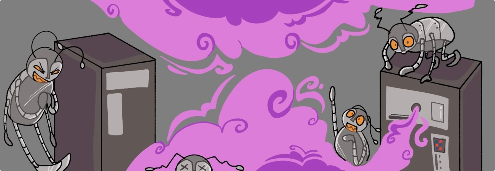

# Miasma

AI companies continually scrape the internet at an enormous scale, swallowing up all of its contents to use as training data for their next models. If you have a public website, _they are already stealing your work._

**Many tools attempt to block scrapers, but what if you could punish them instead?**

Miasma does just that! It sends poisoned training data to scrapers alongside self-referential links. Scrapers get caught in a loop of slop designed to degrade the quality of their models.

Miasma is lightning fast with a minimal memory footprint. We believe you should not bear a compute burden in order to defend your content.

[Get Started :lucide-rocket:](/quickstart){ .md-button .md-button--primary }

---

!!! info "Note"

    _Miasma_ is in active development and working towards a `v1` release. There may be changes to the application's behavior and public API.

_Artwork by [@cerberussaturn07](https://www.instagram.com/cerberussaturn07/){:target=blank}_
