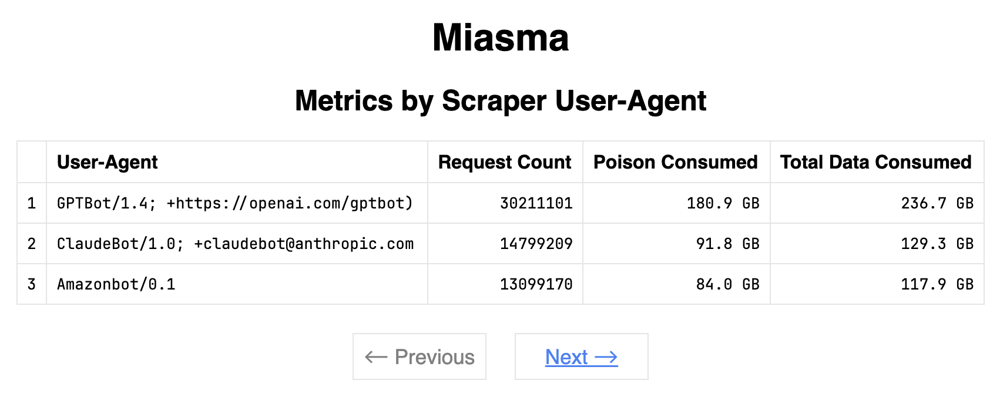

# Metrics

Miasma offers the ability to track scrapers by their [`User-Agent`](https://developer.mozilla.org/en-US/docs/Web/HTTP/Reference/Headers/User-Agent){:target="_blank"}. Total request count, data sent, and poison content consumed are all recorded. This can be useful for identifying which bots are hitting your site most heavily. Note that scrapers frequently use an [obscured `User-Agent`](https://webmasters.stackexchange.com/questions/56239/can-web-crawlers-that-visit-my-site-fake-their-user-agent){:target=blank}, meaning this is not a perfect way to identity who is targeting your site.

Miasma stores collected metrics in a [SQLite](https://en.wikipedia.org/wiki/SQLite){:target="_blank"} file that is used between runs.

## Viewing Metrics

You can view collected metrics via Miasma's dedicated metrics page. This page will be served at an endpoint of your choosing and is protected behind [basic auth](https://developer.mozilla.org/en-US/docs/Web/HTTP/Guides/Authentication#basic_authentication_scheme){:target=blank}.

<figure markdown="span">
{width="850"}
</figure>

## Configuration

Metrics may be configured via command-line arguments, or via a [config file](/config-file).

| Option             | Default    | Description                                                                                                                       |
| ------------------ | ---------- | --------------------------------------------------------------------------------------------------------------------------------- |
| `metrics-db-path`  |            | Path to SQLite database file to store metrics data. Miasma will create a database at this location if one does not already exist. |
| `metrics-username` |            | Basic auth username required to access Miasma's metrics page.                                                                     |
| `metrics-password` |            | Basic auth password required to access Miasma's metrics page.                                                                     |
| `metrics-endpoint` | `/metrics` | Endpoint at which Miasma's metrics will be served.                                                                                |

## Collecting Metrics with Docker

See the [docker setup page](/docker#tracking-metrics).
